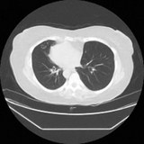
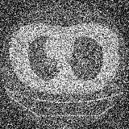

# From Natural Images  to Medical Scans : Transferability of Diffusion Models for Medical Image Generation

<div align="center">


<a href="https://rad-dit.github.io"></a>
<a href="https://huggingface.co/rad-dit"></a>

[Efthymios Georgiou](https://scholar.google.com/citations?user=5Sc6GvEAAAAJ&hl=en), [Ioannis Kakogeorgiou](https://scholar.google.com/citations?user=B_dKcz4AAAAJ&hl=en), [Sarah Brüningk](https://scholar.google.com/citations?user=Wio1KtsAAAAJ&hl=en)

WACV 2027 (Algorithms track)

Official PyTorch implementation of the paper *From Natural Images to Medical Scans*.

</div>

## 🏃 TL;DR

Initialising diffusion transformers with ImageNet weights improves medical image generation, in both latent and pixel space denoising. Natural-image initialisation results in **more spatially structured representations, not more semantic ones**, and this spatial structure (LDS<sub>C</sub>) correlates with generation fidelity. Mixing natural with medical images also improves medical fidelity, while early-to-mid representations stay similar across domains in the mixed model. Last but not least, natural-image pretraining outperforms or matches medical-image pretraining in our setup.

## 💡 Findings

1. Natural-image transfer improves medical image generation.
2. What transfers: spatial structure, not semantics (it helps learn better spatially structured features, not more semantic features).
3. Mixed-domain training helps.
4. Natural-image transfer outperforms medical pretraining (in our setup).

## ⚙️ Setup

You need [uv](https://docs.astral.sh/uv/).

```bash
git clone https://github.com/CAIROLab-Bern/rad-dit.git
cd rad-dit

uv venv --python 3.11 --seed .venv && source .venv/bin/activate
uv pip install -r environment/requirements.lock --index-strategy unsafe-best-match
```

This installs one environment for all the code. For more information, see [`environment/`](environment/).

## 📦 Data

- RadImageNet: https://github.com/BMEII-AI/RadImageNet
- BraTS 2024 GLI: https://www.synapse.org/Synapse:syn53708249/wiki/627759

In this repository, "BraTS" means the BraTS 2024 adult glioma dataset (BraTS-GLI, post-treatment MRI), not all datasets of the BraTS 2024 challenge.

Place data or symlinks to the datasets in [`data/`](data/). Then prepare the data, see [`preprocessing/`](preprocessing/).

## 🏋️ Training and 📝 evaluation

###  Models

| Approach | Description | Directory |
|----------|-------------|-----------|
| **JiT** | Pixel-space diffusion | [`jit/`](jit/) |
| **L(ightning)DiT** | Latent diffusion | [`ldit/`](ldit/) |

- The README in each folder has the commands.
- To aim for higher GPU utilisation, we changed the official code to make data loading and training more efficient. For example, we added shard-based data loaders. See [`preprocessing/`](preprocessing/).
- Run the commands in `jit/` or `ldit/`. There are two options:
  - **SLURM:** replace `<ACCOUNT>` and `<PARTITION>` in `slurm/*.sh` with your own values. Then run `mkdir -p logs` and use the `sbatch` commands.
  - **Local machine or cloud instance (for example AWS):** use `bash` in place of `sbatch`, with the same arguments. Bash ignores the `#SBATCH` lines.

### 🤗 Pretrained models

| Repository | Models | Downloads |
|---|---|---|
| [rad-dit/jit-radimagenet](https://huggingface.co/rad-dit/jit-radimagenet) | JiT-B/16, JiT-L/16, JiT-H/16, JiT-L/16 mixed (15%, 25% ImageNet) |  |
| [rad-dit/ldit-radimagenet](https://huggingface.co/rad-dit/ldit-radimagenet) | LightningDiT-XL/1 |  |
| [rad-dit/ldit-brats](https://huggingface.co/rad-dit/ldit-brats) | LightningDiT-XL/1 |  |

Each model card has the download and generation commands.

### Eval 
- We compute gFID with [`dgm_eval/`](dgm_eval/). 
- [`metrics/`](metrics/) has LDS<sub>C</sub>, our spatial structure metric.

## ⚠️ Known issues

**Multi-GPU jobs hang at start (JiT and LDiT):** if DDP stops at the first barrier with an NCCL timeout, set these flags:

```bash
export NCCL_P2P_DISABLE=1
export NCCL_IB_DISABLE=1
```

## 🔭 Future work

- Efficient dataloading [ongoing]

-  Gradient checkpointing [ongoing]

- FSDP [todo]

## 📄 Citation

```bibtex
@inproceedings{georgiou2027natural,
  title     = {From Natural Images to Medical Scans: Transferability of Diffusion Models for Medical Image Generation},
  author    = {Georgiou, Efthymios and Kakogeorgiou, Ioannis and Br{\"u}ningk, Sarah},
  booktitle = {2027 IEEE/CVF Winter Conference on Applications of Computer Vision (WACV)},
  year      = {2027}
}
```

## 🙏 Acknowledgements

- We thank authors and contributors of [DiT](https://github.com/facebookresearch/DiT), [SiT](https://github.com/willisma/SiT), [LightningDiT](https://github.com/hustvl/LightningDiT), [JiT](https://github.com/LTH14/JiT), [iREPA](https://github.com/End2End-Diffusion/iREPA) and [dgm-eval](https://github.com/layer6ai-labs/dgm-eval).
- We used AI tools, such as [Claude Code](https://claude.com/claude-code), to set up this unified repository.

## 📜 License

Our code is under the [MIT License](LICENSE). Code copied from other projects keeps its own license, next to that code.

## 📧 Contact

For questions, collaborations, or issues, please contact Efthymis.
